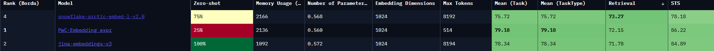

# food-vector-search-lab

> **2026-11-16 · 실서비스 평가 트랙 추가**
> [서비스 사용에서 발견한 문제 → 검색 품질 기준선 → 개선 실험 계획](experiments/service-retrieval/README.md)을 별도로 기록합니다. 기존 Lab CLI와 운영 FastAPI는 코드·인덱스 형식·의존성이 다릅니다. 아래 기존 연구와 새 서비스 평가를 동일 구현의 비교 결과로 읽지 않도록 구분했습니다. 현재는 기준선 평가까지 완료했고, 품질 개선 실험은 아직 실행하지 않았습니다.


음식 DB(`food_data.csv`)를 기반으로 **벡터 검색(Retrieval)**과 **하이브리드 추천(Hybrid Reranking)**을 실험하는 레포입니다.
“사용자가 원하는 음식”을 **자연어 + 간단한 속성 값**으로 표현하면, DB에서 의도에 맞는 후보를 Top-K로 끌어오는 흐름을 검증합니다.

예를 들어 사용자는 이렇게 말할 수 있습니다.

- “**따뜻한 거** 먹고 싶어” (따뜻함 0.7)
- “**운동 후**라서 **단백질 높은 음식**”
- “야식인데 **너무 짜지 않은** 걸로” (sodium_max)
- “달달한 건 싫고 **담백한** 쪽” (당류/자극도 제약)
- “카페인 없는 음료” (caffeine_max)

이 레포의 목표는 위처럼 **모호한 문장과 숫자 조건이 섞인 검색 상황**에서,
- 텍스트 임베딩 기반 검색이 유의미하게 동작하는지
- 영양소 제약(탄/단/지, 나트륨, 당, 카페인 등)으로 후보를 **현실적으로** 좁힐 수 있는지
- 그리고 둘을 결합한 Hybrid 재랭킹이 “납득 가능한 결과”를 만드는지

를 빠르게 확인하는 것입니다.

---

## 1. 프로젝트 배경 (Project Background)

추천 시스템은 결국 “찾기” 문제에 가깝습니다.
사용자는 정확한 음식명을 모르더라도, 느낌이나 상황으로 요구를 던집니다.

- 느낌 축: 따뜻함 0.7, 자극도 0.3, 든든함 0.8
- 상황: 운동 후 / 야근 / 혼밥 / 야식
- 제약 조건: 단백질 ≥ 15g, 나트륨 ≤ 500mg, 당류 ≤ 5g, 카페인 = 0

이 레포는 위 입력들을 바탕으로 **2만 건 수준의 음식 DB**에서
1) 임베딩 기반으로 Top-K 후보를 찾고
2) 필요하면 영양소 기반 점수/필터로 다시 정렬해
3) 최종적으로 “지금 상황에 어울리는 음식”을 추천하는 흐름을 실험합니다.

---

## 2. 요구사항 (Requirements)

- 입력
  - 자연어 쿼리(예: “운동 후 단백질 높은 음식”, “따뜻한 국물”, “야식인데 짜지 않게”)
  - 선택적으로 숫자 조건(예: `protein_min`, `sodium_max`, `sugar_max`, `caffeine_max`)
  - (확장 가능) 슬라이더 기반 선호값(예: 따뜻함 0.7, 자극도 0.2)

- 출력
  - Top-K 검색 결과(음식명/카테고리/핵심 영양소)
  - Hybrid 결과: “텍스트로 뽑은 후보 풀”을 영양소 기반으로 재랭킹한 Top-K

- 목표
  - 사용자의 의도를 **Top-K 안에 넣는 Retrieval 성능**을 우선 검증
  - “텍스트 검색만” vs “텍스트 + 영양소 재랭킹”의 체감 품질 차이 확인

- 제약
  - 한국어 쿼리 처리 필수
  - T4 GPU(16GB) 환경을 고려한 모델 선택 및 추론 비용 관리


---

## 3. 데이터셋 설명 (Dataset)

본 실험에서는 `data/food_data.csv`를 사용합니다.

### 3.1 컬럼 스키마 (MVP)
- 식별/설명
  - `food_code`, `food_name`
  - `cat_large`, `cat_mid`, `cat_small`, `cat_detail`
- 핵심 영양소(100g 기준)
  - `kcal`, `carb_g`, `protein_g`, `fat_g`, `sugar_g`, `sodium_mg`, `caffeine_mg`

---

## 4. 실험 전략 및 전처리 (Strategy & Preprocessing)

### 4.1 Canonical Text 구성
음식 1개를 임베딩하기 위한 대표 문장은 아래 요소를 결합합니다.
- 음식명
- 카테고리
- 영양 요약(100g 기준)

예시:
- `{food_name} | category: ... | nutrition(per100): kcal ..., protein ...`

이 구성은 “DB에 없는 속성(예: 뜨거움/차가움)”이 등장했을 때도
모델이 상식적 추론으로 일부 보완할 수 있는지를 보기 위한 목적도 포함합니다.

### 4.2 인덱스 방식
- 임베딩 벡터는 L2 normalize 후
- FAISS `IndexFlatIP`로 inner-product 기반 검색을 수행합니다.
  (normalize 된 벡터의 inner product는 cosine similarity와 동일)

---

## 5. 모델 선정 (Model Selection)

`2025-12-20` 기준
허깅페이스 MTEB 리더보드에서 다음 과정을 거쳐 최적의 모델을 선정했습니다.

[MTEB Leaderboard](https://huggingface.co/spaces/mteb/leaderboard)

### 1단계: 필터링 (환경 제약 조건 반영)
먼저 T4 GPU와 한국어 환경에 맞는 모델만 남기기 위해 아래 필터를 적용했습니다.
- Language: Korean (kor)
- Model Parameters: 1B 이하

### 2단계: 정렬 (목적 지표 설정)
추천 시스템의 본질인 **사용자의 의도에 맞는 항목 찾기**에 집중하여 지표를 정렬했습니다.
- Primary (내림차순): **Retrieval**
- Secondary (참고): **STS**

### 3단계: 선정
본 실험에서는 단순한 리더보드 순위가 아니라, 모델의 **범용성(Zero-shot)**과 검색력(Retrieval)을 고려하여 최적의 모델을 선정했습니다.



#### 1. Snowflake/snowflake-arctic-embed-l-v2.0
- Retrieval 점수 상위권
- 풍부한 설명문(카테고리+영양 요약)이 있을 때 강한 검색 성능 기대

#### 2. jina-embeddings-v3
- zero_shot_percentage 100%
- 설명이 부족하거나 모호한 쿼리에서 상식 기반 보완 능력 기대

#### 3. 기각 모델: PwC-Embedding_expr
- 낮은 범용성(Zero-shot 16~25%)으로 인한 오버피팅 위험

### 실험 가설 (Experimental Hypothesis)
- Snowflake 모델은 풍부한 영양소 설명문이 주어질 때 최고의 검색 성능을 보여줄 것이다.
- Jina 모델은 설명이 부족하거나 모호한 쿼리에 대해 모델 특유의 '직관'으로 부족한 속성을 보완하여 추천할 것이다.
- OpenAI Embedding 모델은 유료 API로서 위 로컬 모델들의 성능 지향점을 판단하는 역할을 수행한다.

---

## 6. 실험 설계 (Experimental Design)

### 6. 결론 요약
#### 결론 1
```
임베딩 검색은 “의도 후보를 모으는 도구”이지,
정답을 바로 주는 도구가 아니다

"뜨끈한 국물" → 커피/차류가 상위로 쏠리는 현상 다수 발생

이유:

임베딩 모델은
“뜨겁다 = HOT = 음료” 같은 언어적 연관성을 강하게 학습함

음식 DB에는 “온도”라는 개념이 명시적으로 존재하지 않음
```

#### 결론 2
```
카테고리 가드레일은 drop이 아니라 score 조정이어야 한다

초반 시도:

  food 검색 시 음료/차류를 강제로 제거

  결과: 후보가 통째로 비어버리는 케이스 발생

현재 방식:

  cat_large 기준으로

  의도와 다른 카테고리는 감점

  일치하는 카테고리는 소폭 가산

hard filter (drop) 방식 비추

soft guardrail (penalty / bonus) 감점 방식으로 진행

>> Retrieval 단계에서는 과하게 거르지 않는다
```

#### 결론 3
```
“뜨끈함 / 시원함” 같은 감각은
쿼리 확장 + 후처리로 다루자

DB에 없는 개념을

 임베딩 하나로 해결하려 하면 망함

대신

  쿼리 확장 (국/탕/찌개 힌트)

  카테고리 가드레일

  영양소 재랭킹

  다양화 후처리

>> 여러 약한 신호를 합쳐서 방향만 맞춘다
```
### 6. 검색 flow
```
[Query]
   ↓
(Query Expansion, optional)
   ↓
Vector Retrieval (FAISS)
   ↓
Category Guardrails (score 조정)
   ↓
Diversify (중복 토큰/카테고리 제한)
   ↓
(optional) Nutrient Filter
   ↓
(optional) Hybrid Re-ranking
   ↓
Top-K Results
```
---

## 7. 실행 방법 (How to Run)

### 7.1 설치
```bash
python -m venv .venv
# Windows
.venv\Scripts\activate
# macOS/Linux
source .venv/bin/activate

pip install -r requirements.txt
```

### 7.2 데이터 준비
- `data/food_data.csv` 위치에 csv 파일 저장

### 7.3 인덱스 생성(모델별)
```bash
python -m src.cli build-index --model snowflake
python -m src.cli build-index --model jina
```
### 7.4 텍스트 검색 (Retreval)
ver1
```bash
python -m src.cli search --model snowflake --q "운동 후 단백질 많은 음식" --topk 10
python -m src.cli search --model jina --q "운동 후 단백질 많은 음식" --topk 10
```
ver2 중복 토큰 방지 및 쿼리 확장
```bash
python -m src.cli search \
  --model snowflake \
  --kind food \
  --q "뜨끈한 국물" \
  --topk 10 \
  --use-query-expansion \
  --debug
```

### 7.5 영양소 기반 추천 (Nutreint-only Rerank)
```bash
python -m src.cli recommend \
  --protein-min 15 \
  --sodium-max 500 \
  --topk 10
```
### 7.6 Hybrid (검색 -> 영양소 재랭킹)
```bash
python -m src.cli hybrid \
  --model snowflake \
  --kind food \
  --q "야식" \
  --sodium-max 400 \
  --use-query-expansion \
  --topk 10
```
### 7.7 모델 비교 리포트 생성 (Snowflake vs Jina)
```bash
python -m src.cli compare --topk 10 --use-query-expansion --use-diversify --use-guardrails
```
- 결과는 `outputs/reports/compare_YYYYMMDD_HHMMSS/`에 저장됩니다.
- `summary.csv` : 쿼리별 Top-K 음식명 리스트 요약
- `hits_{model}_{query}.csv` : 각 모델의 상세 검색 결과
***
## 8. 결과 정리 (Results)
### 8.1 모델별 비교

### 8.2 case study

### 8.3 개선 아이디어

***
## 9. 참고 문헌 및 링크
- [MTEB Leaderboard](https://huggingface.co/spaces/mteb/leaderboard)
- [Snowflake Arctic Embed v2.0](https://huggingface.co/Snowflake/snowflake-arctic-embed-l-v2.0)
- [Jina Embeddings v3](https://huggingface.co/jinaai/jina-embeddings-v3)
